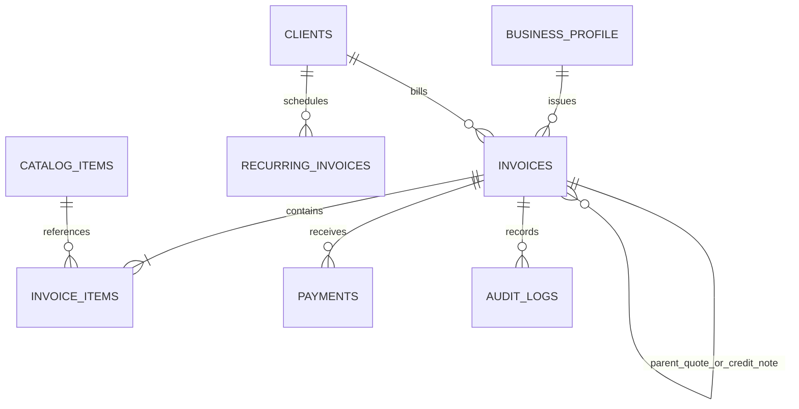

# Personal Invoice Studio ⚡️

A high-performance, single-user invoice generator designed specifically for freelance software engineers and consultants. Built with **monolithic simplicity**, **strict integer-cents financial math**, and **server-side PDF generation** with zero headless browser bloat.

---

## 🛠 Tech Stack & Architecture

- **Backend Framework**: Laravel 11 / PHP 8.2+
- **Database**: SQLite in **WAL Mode** (`PRAGMA journal_mode = WAL`) with busy timeout resilience
- **Frontend Layer**: Blade + [Alpine.js](https://alpinejs.dev) + [Tailwind CSS 4](https://tailwindcss.com) + [SortableJS](https://sortablejs.github.io/Sortable/) (drag-to-reorder line items)
- **PDF Engine**: Pure server-side via [DomPDF](https://github.com/barryvdh/laravel-dompdf) (Selectable **A4** and **US Letter**, zero Chromium/Puppeteer overhead)
- **Financial Precision**: Zero floating-point calculations. All currency amounts are stored and calculated in **integer cents** (`_cents`), with taxes and discounts calculated in **basis points** (`_bps`, e.g., 2100 = 21.00%).

---

## 🚀 Quick Start & Setup

### 1. Requirements
- PHP 8.2+ with SQLite and GD / MBString extensions
- Node.js 18+ and npm
- Composer 2+

### 2. Installation

```bash
# 1. Clone repository & install backend dependencies
git clone <repo_url> invoice-studio
cd invoice-studio
composer install --no-interaction

# 2. Install frontend dependencies & compile assets
npm install
npm run build

# 3. Environment configuration
cp .env.example .env
php artisan key:generate

# 4. Initialize SQLite database & run migrations
touch database/database.sqlite
php artisan migrate

# 5. Populate sample clients, catalog items, and invoices across all lifecycle states
php artisan db:seed

# 6. Start the local server
php artisan serve
```

Visit [http://localhost:8000](http://localhost:8000) in your browser.

---

## ⚙️ Environment Variables (`.env`)

| Variable | Default | Description |
|---|---|---|
| `LOCAL_MODE` | `true` | When `true`, automatically bypasses login for seamless local development. When `false`, requires `APP_PASSWORD`. |
| `APP_PASSWORD` | `secret123` | Master password for locking the studio in single-user VPS deployments. |
| `DB_CONNECTION` | `sqlite` | Primary database driver. |
| `DB_JOURNAL_MODE` | `WAL` | Enables SQLite Write-Ahead Logging for high concurrency without locks. |
| `DB_BUSY_TIMEOUT` | `5000` | SQLite lock wait timeout in milliseconds. |

---

## 🏛 Database Schema & Domain Invariants



### Core Invariants:
1. **Zero Float Financial Engine**: Unit prices and line totals are stored in integer cents (`subtotal_cents`, `tax_total_cents`, `total_cents`, `balance_cents`). Quantity supports 4 decimal places (`decimal(12, 4)`) for fractional billable hours (e.g. `3.7500` hours).
2. **Immutable Audit Trail & Finalization Lock**:
   - Invoices in `draft` state can be freely edited.
   - Once finalized (`sent`, `partially_paid`, `paid`, `void`), invoices become **permanently locked**.
   - Any revisions must be executed via **Duplicate** or **Credit Note**, preserving invoice numbering continuity without gaps.
3. **Automatic Lifecycle Transition**:
   - `draft` &rarr; `sent` (on finalization)
   - `sent` &rarr; `partially_paid` (when payment > 0 and < total)
   - `partially_paid` &rarr; `paid` (when balance reaches 0)
   - `overdue` (evaluated dynamically whenever due date is past and balance > 0)
   - `void` (explicitly cancelled while retaining sequence number).

---

## 📄 PDF Templates & Customization

The system provides 3 pre-built server-side templates with dynamic page size (`A4` vs `US Letter`) and bilingual localization (`en` vs `es`):

1. **Modern** (`resources/views/invoices/pdf/modern.blade.php`): Clean, vibrant contemporary layout with QR code payment box and status watermark.
2. **Classic** (`resources/views/invoices/pdf/classic.blade.php`): Traditional corporate layout with serif typography and clean borders.
3. **Minimal** (`resources/views/invoices/pdf/minimal.blade.php`): Swiss high-modern layout, clean whitespace, and typography-first balance.

### Adding or Customizing a Template:
- All PDF views are located in `resources/views/invoices/pdf/`.
- Templates receive `$invoice`, `$profile`, `$client`, `$items`, `$payments`, `$locale`, and `$qrCodeSvg`.
- Translations are managed in `lang/en/invoice.php` and `lang/es/invoice.php`.
- The template selector in **Studio Settings** or the **Invoice Builder** applies choices immediately.

---

## 🔄 Recurring Invoices Automation

Recurring schedules can be configured as weekly, bi-weekly, monthly, quarterly, or yearly.

To trigger recurring invoice generation automatically on a VPS or via cron, add this entry to crontab:

```bash
* * * * * cd /path-to-your-project && php artisan schedule:run >> /dev/null 2>&1
```

Or run manually via Artisan:

```bash
php artisan invoices:generate-recurring
```

---

## 💾 Backups & Data Safety

In **Studio Settings &rarr; Data Safety**, you can execute:

1. **1-Click SQLite Snapshot**: Generates an atomic copy of `database.sqlite` via SQLite `VACUUM INTO` without taking the site offline.
2. **Database Restore**: Upload any previously downloaded `.sqlite` file to restore (a timestamped safety backup of the active database is created automatically prior to restoration).
3. **JSON Export**: Complete dump of all clients, catalog items, invoices, line items, and payments for migration or scripting.
4. **Accountant CSV Export**: Filter invoices by date range and download a formatted spreadsheet ready for your accountant or tax declaration.

---

## 🧪 Running Automated Tests

Run the full PHPUnit suite:

```bash
./vendor/bin/phpunit
```

Test coverage includes:
- `tests/Unit/InvoiceCalculationServiceTest.php`: Integer-cents math, basis-point taxes, fractional hours, tax-inclusive vs tax-exclusive, and deterministic rounding.
- `tests/Feature/InvoiceDomainTest.php`: Lifecycle states, payments, balance recalculation, duplication, and credit notes.
- `tests/Feature/PdfGenerationTest.php`: Binary PDF output across all 3 templates, dual page sizes, and bilingual translations.
- `tests/Feature/InvoiceWorkflowTest.php`: End-to-end integration across routes, modals, and exports.

---

## 🚢 Next Steps & Optional Enhancements

- **Direct Stripe Checkout / Payment Gateway**: Webhook listener to automatically record payments when client pays via Stripe link.
- **Client Email Tracking**: Track pixel or delivery confirmation for invoices sent via SMTP.
- **Time Tracker Integration**: Simple timer widget on the dashboard that converts logged hours into invoice line items.
- **Multi-tenant / Multi-profile**: Ability to switch between multiple business entities or freelancing brands under one installation.
